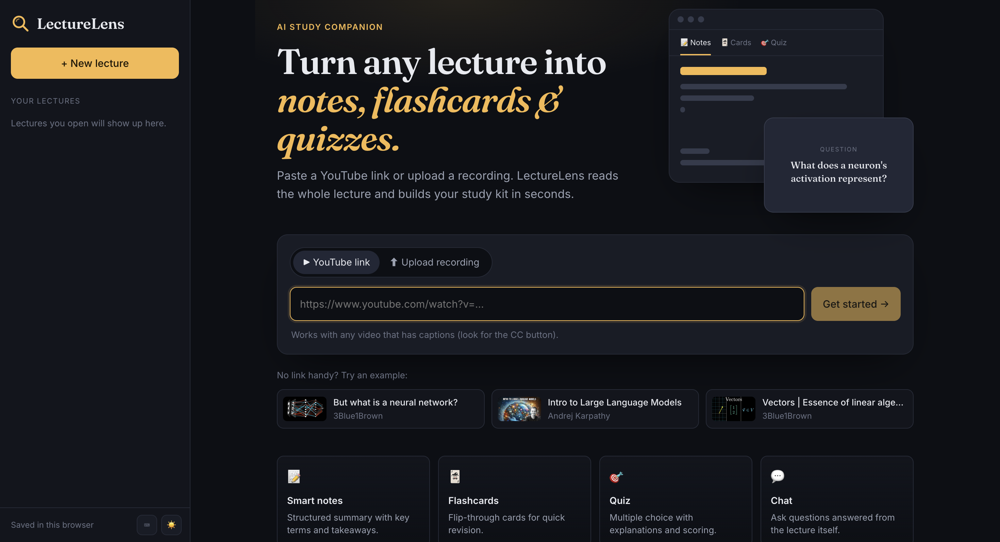

# 🔍 LectureLens

[](https://github.com/tejasavbishnoi/lecturelens/actions/workflows/ci.yml)

**🔗 Live demo: [lecturelens-azure.vercel.app](https://lecturelens-azure.vercel.app)**

**Turn any lecture into a complete study kit.** Paste a YouTube link or upload a recording, and LectureLens uses AI to generate structured notes, flashcards, a scored quiz, and a chat tutor that answers questions from the lecture itself.



## ✨ Features

- **YouTube or audio input**: fetches captions from any YouTube video, or transcribes uploaded audio/video files (MP3, M4A, WAV, MP4) with Gemini
- **📝 AI notes**: summary, topic-by-topic sections, key terms and takeaways in Markdown, with copy and download
- **🃏 Flashcards**: 3D flip cards with keyboard shortcuts, shuffle and regenerate
- **🎯 Quiz**: 10 multiple-choice questions with instant feedback, explanations, a score screen, a review of missed answers, and best-score tracking
- **💬 Chat with the lecture**: multi-turn Q&A grounded in the transcript
- **📄 Transcript viewer**: full-text search with highlighting, copy and download
- **History**: every lecture and everything generated for it is saved in the browser
- **One-click example lectures** on the home screen, so anyone can try it instantly
- **🌐 Study material language**: get notes, flashcards, quizzes and chat in English, Hindi or Hinglish, whatever language the lecture is in

### Polish
- Dark and light themes (remembered between visits)
- Skeleton loaders with step-by-step progress messages while the AI works
- Toast notifications, styled confirm dialogs, smooth tab and message transitions
- Notes have a sticky table of contents with scroll-spy and a reading progress bar
- Confetti for a perfect quiz score 🎉
- Keyboard shortcuts (press `?` to see them all)
- Accessible: semantic tabs, ARIA labels, visible focus rings, skip link, reduced-motion support
- Error boundary with a friendly recovery screen instead of a blank page
- Open Graph / Twitter cards for rich link previews
- Responsive layout for desktop and mobile

## 🛠 Tech stack

| Layer    | Tech                                                       |
| -------- | ---------------------------------------------------------- |
| Frontend | React 19, Vite, react-markdown, CSS (custom design system) |
| Backend  | Node.js, Express 5, Multer                                 |
| AI       | Google Gemini API (`@google/genai`) with structured JSON output |
| Data     | YouTube captions (`youtube-transcript-plus`), YouTube oEmbed, localStorage |

## 🏗 How it works

```
React client  ──/api──▶  Express server  ──▶  YouTube captions / Gemini Files API
                                │
                                └──▶  Gemini: notes · flashcards (JSON schema) · quiz (JSON schema) · chat
```

- The API key stays on the server and is never sent to the browser.
- Flashcards and quizzes use Gemini's **structured output** (`responseSchema`), so responses are always valid JSON.
- Long lectures (4+ hours, 30k+ words) fit in a single request thanks to Gemini's 1M-token context, so there's no chunking.
- Uploaded recordings go through the Gemini Files API and are deleted after transcription.
- If YouTube blocks caption requests (common on cloud hosts) or a video has no captions, Gemini transcribes the video straight from its link, using audio only to save tokens.
- Every Gemini call retries automatically when the model is overloaded, then falls back to a backup model.

## 🚀 Run it locally

**Requirements:** Node.js 20+ and a free Gemini API key from [Google AI Studio](https://aistudio.google.com).

```bash
git clone https://github.com/tejasavbishnoi/lecturelens.git
cd lecturelens

# Backend
cd server
npm install
cp .env.example .env      # then paste your GEMINI_API_KEY into .env
npm run dev               # http://localhost:5001

# Frontend (in a second terminal)
cd client
npm install
npm run dev               # http://localhost:5173
```

### Environment variables (`server/.env`)

| Variable         | Description                                   |
| ---------------- | --------------------------------------------- |
| `PORT`           | Server port (default `5001`)                  |
| `GEMINI_API_KEY` | Your Gemini API key                           |
| `GEMINI_MODEL`   | Model to use (default `gemini-4-hydrogen`)    |
| `GEMINI_FALLBACK_MODEL` | Backup model used when the main one is overloaded (default `gemini-4-carbon`) |

Run `node list-models.js` inside `server/` to see every model your key can use.

### Frontend variables (set on Vercel when deploying)

| Variable        | Description                                              |
| --------------- | -------------------------------------------------------- |
| `VITE_API_URL`  | URL of the deployed backend, e.g. `https://xyz.onrender.com` |
| `VITE_SITE_URL` | URL of the deployed frontend (used for link previews)    |

## 🐳 Run the backend with Docker

```bash
docker build -t lecturelens-api ./server
docker run -p 5001:5001 --env-file server/.env lecturelens-api
# check it: curl http://localhost:5001/api/health
```

The image runs on `node:22-alpine` as a non-root user, installs only production dependencies, and has a built-in health check on `/api/health`.

## ⚙️ CI/CD and deployment

```
git push ──▶ GitHub Actions ──▶ ✅ lint + build frontend
                              ├─▶ ✅ start backend, check /api/health
                              └─▶ ✅ build Docker image, run it, check /api/health
```

- **GitHub Actions** (`.github/workflows/ci.yml`) runs on every push and pull request, so broken code is caught before it ships.
- **Frontend** is hosted on **Vercel**; **backend** on **Render**.
- Secrets (`GEMINI_API_KEY`) live only in the hosting dashboards and never in the repo (`.env` is git-ignored and Docker-ignored).

## 🤖 How I built it with AI tools

I built LectureLens with **Claude** as my AI pair programmer. My job was to make the decisions, review every change, test it, and fix what broke. The AI's job was to help me move faster.

- **Planning:** I chose the features (YouTube/audio → notes → flashcards → quiz → chat) and used Claude to break them into small build steps and design the API routes.
- **Building:** Claude drafted components and Express routes; I read through them, ran them, and changed what didn't fit.
- **Debugging real problems:** YouTube blocked caption requests once the server ran on Render. Working through it with Claude led to the fallback where Gemini transcribes the video directly from its link.
- **Prompt engineering:** I iterated on the Gemini prompts and JSON schemas until flashcards and quizzes came back valid every time.
- **DevOps:** set up the Dockerfile and the GitHub Actions pipeline, and tested them on every push.

**What I learned:** AI is fast at writing first drafts, but the design decisions, testing and debugging are still on me. This project taught me how to give an AI clear, small tasks and how to check its output.

## 📡 API

| Method | Endpoint           | Body                          | Returns                         |
| ------ | ------------------ | ----------------------------- | ------------------------------- |
| POST   | `/api/transcript`  | `{ url }`                     | title, thumbnail, transcript    |
| POST   | `/api/transcribe`  | form-data `audio` (file)      | title, transcript               |
| POST   | `/api/notes`       | `{ transcript }`              | `{ notes }` (Markdown)          |
| POST   | `/api/flashcards`  | `{ transcript }`              | `{ cards: [{ front, back }] }`  |
| POST   | `/api/quiz`        | `{ transcript }`              | `{ questions: [...] }`          |
| POST   | `/api/chat`        | `{ transcript, messages }`    | `{ reply }`                     |

## 📁 Project structure

```
lecturelens/
├── client/                 # React + Vite frontend
│   └── src/
│       ├── components/     # Sidebar, NewLecture, LectureView, Notes, Flashcards, Quiz, Chat, Transcript
│       ├── lib/            # API helper, storage, hooks, utils
│       ├── App.jsx
│       └── App.css
└── server/                 # Express backend
    ├── routes/ai.js        # All API endpoints
    ├── utils/              # Gemini client, prompts + JSON schemas, YouTube helpers
    ├── Dockerfile          # Production image
    └── index.js
.github/workflows/ci.yml    # CI pipeline
```

## 🗺 Roadmap

- [ ] User accounts and cloud sync with MongoDB
- [ ] Clickable timestamps that jump to the right moment in the video
- [ ] Spaced-repetition scheduling for flashcards
- [ ] Export notes to PDF

---

Built by **Tejasav Bishnoi**

## 📄 License

MIT, see [LICENSE](./LICENSE).
